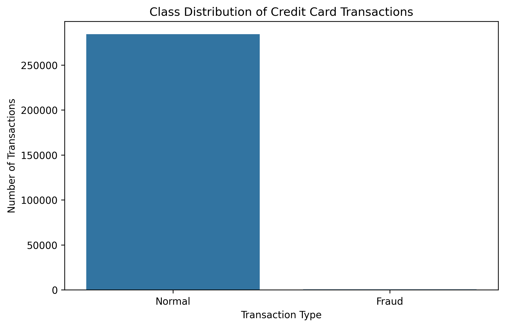
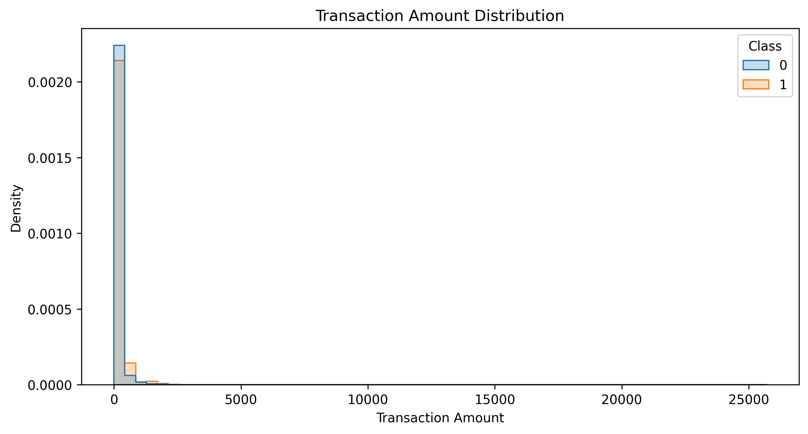
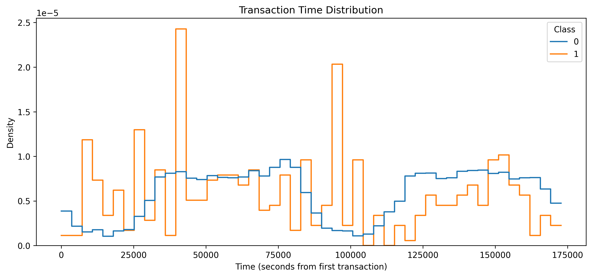

# Fraud-detection
# Can Machine Learning Detect Credit Card Fraud?

## TL;DR

A data science project exploring machine learning and anomaly detection techniques to identify fraudulent credit card transactions.

The dataset contains **284,807 transactions**, including only **492 fraudulent transactions (0.173%)**.

The challenge is to detect fraudulent transactions while minimizing false alarms.

**Current Progress:** Exploratory Data Analysis (EDA) completed. Model development is next.

## The Question

Can machine learning identify fraudulent credit card transactions in a highly imbalanced dataset?

Can we detect fraud effectively without incorrectly flagging too many genuine transactions?

## Dataset

- **Source:** ULB Machine Learning Group
- **Total Transactions:** 284,807
- **Normal Transactions:** 284,315
- **Fraudulent Transactions:** 492
- **Fraud Percentage:** 0.173%
- **Features:** 30 input features and 1 target column

Dataset: [Credit Card Fraud Detection – Kaggle](https://www.kaggle.com/datasets/mlg-ulb/creditcardfraud)

## Method

The project follows these stages:

1. **Exploratory Data Analysis:** Understand class imbalance, transaction amounts and transaction timing.
2. **Data Preparation:** Prepare features and create stratified training and testing datasets.
3. **Model Development:** Compare Logistic Regression, Isolation Forest and Local Outlier Factor.
4. **Model Evaluation:** Use Precision, Recall, F1-score and PR-AUC.
5. **Threshold Tuning:** Understand the trade-off between missed fraud and false alarms.
6. **Interpretation:** Analyze model behaviour and limitations.
7. **Deployment:** Build an interactive Streamlit fraud detection application.

## Results – Exploratory Data Analysis

### 1. Class Distribution



Only 0.173% of transactions are fraudulent, indicating severe class imbalance.

### 2. Transaction Amount Distribution



| Statistic | Normal | Fraud |
|---|---:|---:|
| Mean | 88.29 | 122.21 |
| Median | 22.00 | 9.25 |
| Maximum | 25,691.16 | 2,125.87 |

Fraudulent transactions have a higher mean but a lower median amount. This suggests that a few larger transactions influence the average.

### 3. Transaction Time Distribution



| Statistic | Normal | Fraud |
|---|---:|---:|
| Mean | 94,838.20 | 80,746.81 |
| Median | 84,711 | 75,568.5 |

Fraudulent transactions show lower average and median elapsed times compared with normal transactions. However, time alone cannot reliably identify fraud.

## Model Comparison

Model evaluation will be added after training.

| Model | Precision | Recall | F1-score | PR-AUC |
|---|---|---|---|---|
| Baseline | Pending | Pending | Pending | Pending |
| Logistic Regression | Pending | Pending | Pending | Pending |
| Isolation Forest | Pending | Pending | Pending | Pending |
| Local Outlier Factor | Pending | Pending | Pending | Pending |

*No model performance results have been claimed yet.*

## Conclusion

Initial analysis shows that credit card fraud detection is challenging because fraudulent transactions represent only a small portion of the dataset.

The next stage will focus on developing machine learning models that can identify rare fraudulent transactions using appropriate evaluation metrics.

## Limitations

- The dataset contains only two days of transactions from 2013.
- Most input features are anonymized using PCA.
- The dataset may not represent current fraud patterns.
- Severe class imbalance makes model evaluation challenging.

## What I'd Do Next

- Compare supervised and unsupervised detection techniques.
- Tune classification thresholds.
- Improve fraud detection while controlling false alarms.
- Build a Streamlit application.
- Explore newer fraud detection datasets.

## Run It

### 1. Clone the repository

```bash
git clone https://github.com/jashan2128/fraud-detection-anomaly.git
cd fraud-detection-anomaly
```

### 2. Create a virtual environment

```bash
python -m venv venv
```

### 3. Activate the environment (Windows PowerShell)

```powershell
.\venv\Scripts\Activate.ps1
```

### 4. Install dependencies

```bash
pip install -r requirements.txt
```

### 5. Download the dataset

Download the [Credit Card Fraud Detection dataset from Kaggle](https://www.kaggle.com/datasets/mlg-ulb/creditcardfraud).

Place `creditcard.csv` inside:

```text
data/raw/creditcard.csv
```

### 6. Explore the notebook

Open `notebooks/02_eda.ipynb` using VS Code or Jupyter Notebook.

---

**Built by Jashanpreet Singh**

Data Science Student | Machine Learning | Anomaly Detection
